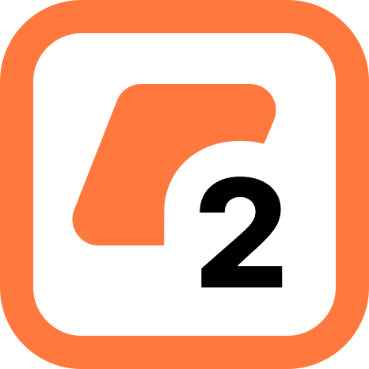
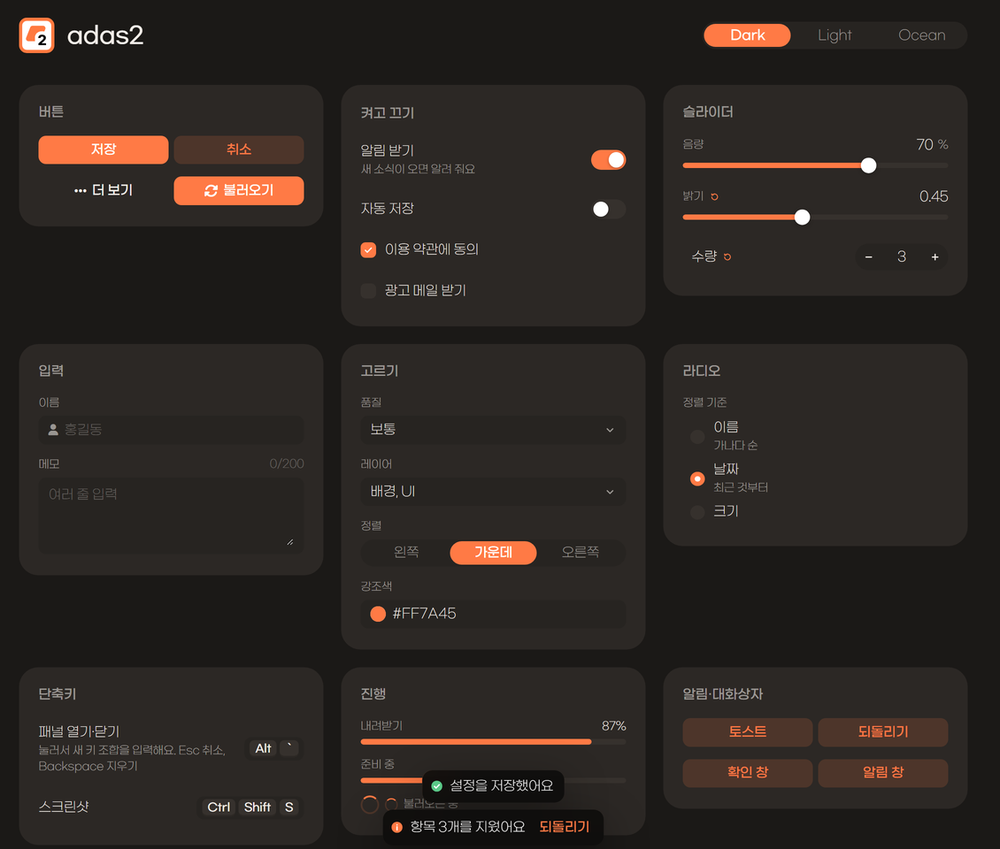
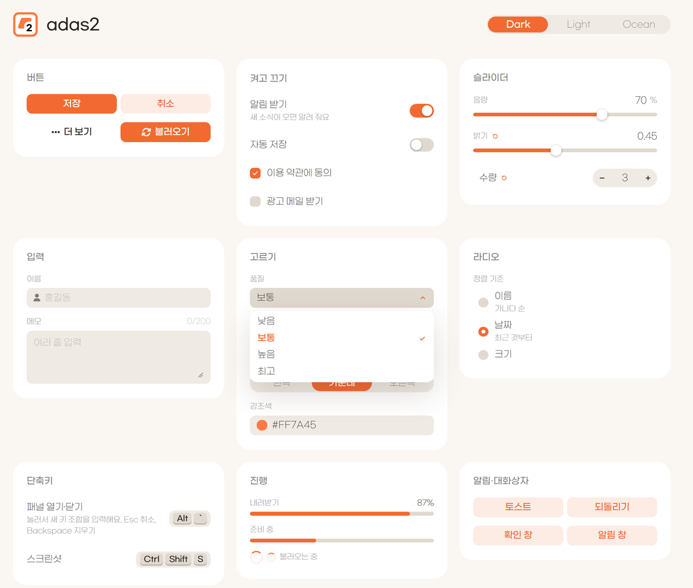

<div align="center">



# adas2

A UI toolkit for the web

[한국어](README.md) · **English** · [Demo](https://adas2-six.vercel.app)

[](https://github.com/a2den1/adas2/releases)

[](LICENSE)

</div>

<p align="center">
  
  
</p>

## Overview

Input components — buttons, switches, sliders, selects, a color picker, tabs — plus panels, toasts, dialogs and menus in one toolkit.

- No runtime dependencies. Load one CSS file and one JS file.
- Build screens line by line with the builder (`adas2.ui`), or create components directly.
- Three themes (dark, light, ocean), with colors, sizes and fonts all adjustable.
- Components with a default show a reset (↺) button once the value changes.
- Number inputs accept expressions such as `50+25` or `x*2` (x is the current value).

## Install

### CDN

```html
<link rel="stylesheet" href="https://cdn.jsdelivr.net/gh/a2den1/adas2@v3.0.0/dist/adas2.min.css">
<script src="https://cdn.jsdelivr.net/gh/a2den1/adas2@v3.0.0/dist/adas2.min.js"></script>
```

The font (Gmarket Sans) is loaded by the CSS.

### npm

```bash
npm install github:a2den1/adas2
```

```js
import adas2 from 'adas2';
import 'adas2/css';
```

Browser only.

## Getting started

```js
adas2.setup({ theme: 'dark', scale: 0.6 });   // optional

const ui = adas2.ui('#settings');

ui.switch('Notifications', { value: true, default: true });
ui.slider('Volume', { min: 0, max: 100, value: 70, unit: '%', onChange: v => console.log(v) });
ui.select('Quality', ['Low', 'Medium', 'High'], { value: 'Medium' });
ui.button('Save', () => adas2.toast('Saved', { type: 'success' }));

ui.section('Advanced', { collapsible: true, toggle: true }, s => {
  s.stepper('Retries', { min: 0, max: 10, value: 3 });
  s.keybind('Quick save', { value: 'Ctrl+KeyS', onPress: save });
});
```

## Components

Every builder method returns the component. Components have `.value`, `.set(v)`, `.reset()`, `.on('change' | 'commit', fn)`, `.disable()` and `.destroy()`.

| Builder | Main options | Description |
|---|---|---|
| `button(text, onClick)` | `variant` (primary, soft, ghost, danger) `icon` `size` `block` | Button. `setLoading(true)` shows a busy state |
| `switch(label)` | `value` `default` `description` | Switch on the right |
| `checkbox(label)` | `value` `default` `description` | Check on the left |
| `radio(label, options)` | `value` `default` | One of several rows; options may have a `description` |
| `slider(label)` | `min` `max` `step` `value` `default` `unit` `decimals` `format` | Click or drag the track, click the number to type |
| `stepper(label)` | `min` `max` `step` `value` `default` `unit` | − / + buttons, repeats while held |
| `field(label)` | `placeholder` `icon` `multiline` `maxLength` `type` | Text input |
| `select(label, options)` | `value` `default` `placeholder` | List that drops down |
| `multiSelect(label, options)` | `value` (array) `summary` | Multiple selection |
| `segmented(options)` | `value` `label` `default` | One of 2–5 options |
| `color(label)` | `value` `default` `presets` | Saturation/value square, hue and alpha bars, hex, presets |
| `keybind(label)` | `value` `default` `onPress` `hold` | Shortcut input; with `onPress` the shortcut works right away |
| `progress(label)` | `value` (0–1, `null` for indeterminate) `showValue` | Progress bar |
| `spinner()` | `size` | Spinner |
| `tabs(tabs)` | `value` | `[{ label, build: t => ... }]`, content slides when switching |
| `section(title, opts, fill)` | `description` `toggle` `collapsible` `collapsed` `actions` | Group under a heading |
| `scroll(opts, fill)` | `height` | Smooth scrolling area |
| `row(fill)` `stack(fill)` `text(t)` `title(t)` `divider()` | | Layout and text |

All options also accept `id` (look up later with `adas2.get(id)`), `tooltip`, `className`, `onChange` and `onCommit`.

## Panels, notifications, menus

```js
// Floating panel: drag the top to move, resize from the edges when resizable
const p = adas2.panel({ title: 'Settings', width: 640, height: 820, resizable: true }, ui => {
  ui.switch('Dark screen', { value: true });
});
p.show(); p.hide(); p.toggle(); p.on('close', () => {});

adas2.toast('Saved', { type: 'success' });                         // info · success · warning · error
adas2.toast('Deleted 3 items', { action: { label: 'Undo', onClick: undo } });

if (await adas2.confirm('Delete this?', { title: 'Delete', ok: 'Delete', danger: true })) remove();
await adas2.alert('Update finished.');
const v = await adas2.dialog({ title, message, buttons: [{ label: 'Later', value: 0 }, { label: 'Now', value: 1, variant: 'primary' }] });

adas2.menu(element, [                                              // right-click menu
  { label: 'Copy', icon: 'fa-regular fa-copy', shortcut: 'Ctrl+C', onSelect: copy },
  '-',
  { label: 'Delete', danger: true, onSelect: remove },
]);

adas2.tooltip(element, 'Description');
```

## Shortcuts

```js
const k = adas2.keys.bind('Alt+Backquote', togglePanel, { hold: 0.6, onHold: resetLayout });
k.rebind('Ctrl+KeyK');
k.unbind();
```

Keys use `KeyboardEvent.code` (`KeyS`, `Backquote`, …); `Ctrl` `Alt` `Shift` `Meta` match either side. Shortcuts pause while a text input is focused.

## Themes

```js
adas2.setTheme('light');                                           // 'dark' · 'light' · 'ocean'
adas2.setTheme(adas2.themes.dark.extend({ accent: '#4C8DFF', radius: 10 }));
adas2.setup({ scale: 0.7, animation: 1.5 });                       // overall size, animation speed (0 turns it off)
```

| Theme value | Description |
|---|---|
| `bg` `surface` `surfaceHover` `surfaceActive` `raised` | Background, controls, hover, pressed, floating surfaces |
| `accent` `accentHover` `accentPressed` `accentSoft` `onAccent` | Accent and text on it |
| `text` `textMuted` `textFaint` | Text |
| `danger` `success` `warning` | Status colors |
| `radius` `radiusLarge` `controlHeight` `fontSize` `fontSizeSmall` `fontSizeTitle` | Sizes (design units, multiplied by `scale`) |
| `font` `weight` `weightStrong` | Font and weights |

## Other tools

- `adas2.animate(from, to, { duration, ease, onUpdate, onDone })` — value animation. Eases: `Linear`, `In`/`Out`/`InOut` × `Sine` `Quad` `Cubic` `Quart` `Quint` `Expo` `Circ` `Back` `Elastic` `Bounce`
- `adas2.evaluate('x*2', { x: 5 })` — the expression evaluator used by number inputs

## Development

```bash
npm install
npm run build      # src/ → dist/
npm run dev        # http://localhost:5880/docs/
```

| Path | Contents |
|---|---|
| `src/core/` | Settings, theme, animation, panel, floating layer, tooltip, shortcuts |
| `src/components/` | Components |
| `src/ui.js` | Builder |
| `src/styles/` | CSS |
| `types/` | TypeScript declarations |

Browsers: Chrome / Edge 111+, Safari 16.4+, Firefox 121+

## License

[adas2 License 1.0](LICENSE). This is not an open-source license.

| Allowed | Not allowed |
|---|---|
| Free use in personal and commercial projects | Modifying the source or distributed files |
| Loading via CDN or npm | Creating derivative works such as forks |
| Shipping unmodified files inside your product | Copying it and distributing or selling it as a separate library or template |
| Restyling through themes, options and the API | Presenting it as your own work |

The font (Gmarket Sans) is not bundled; it loads from a CDN and its copyright belongs to Gmarket. © 2026 a2den1
